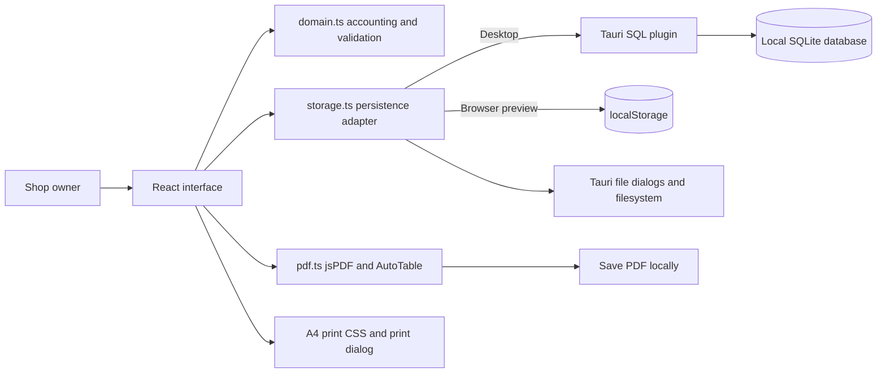

# Architecture and data flow

## Components

## Frontend entry

`index.html` mounts `src/main.tsx`, which mounts `App` inside React StrictMode and loads `styles.css`.

`App.tsx` owns the loaded store, selected customer, search text, date range, page selection, modal selection, loading/busy state, notices and errors. React state is refreshed from persistence after saves.

The app has no router dependency. A `page` state chooses ledger or shop profile. Dialog state chooses customer form, transaction form or restore confirmation.

## Backend/native entry

`src-tauri/src/main.rs` invokes `alfazal_ledger_lib::run()` in `lib.rs`.

The Tauri builder installs:
1. SQL plugin with SQLite and registered migrations 1 and 2.
2. Native dialog plugin.
3. Native filesystem plugin.

`tauri.conf.json` preloads `sqlite:alfazal.db`. Rust includes SQL migration files with `include_str!`. No custom Rust business-command API is currently defined; frontend persistence uses the SQL plugin's parameterized execute/select API.

## Persistence choice

`desktop = isTauri()` in `storage.ts` is the single environment switch.

- Desktop always loads SQLite through `Database.load('sqlite:alfazal.db')`.
- Browser preview reads/writes `localStorage['alfazal-browser-preview-v1']`.
- A native database failure is reported; the app does not silently fall back to browser data.
- The database promise is cached for the process. Restarting the application can be necessary after a failed initial load; no retry/reset helper is currently implemented.
- Browser and desktop records do not automatically synchronize.

## Write flow

1. Form collects customer, profile or transaction fields.
2. Domain/profile validation checks dates, amounts and required fields.
3. Storage uses a parameterized UPSERT or profile UPDATE; browser writes a serialized store.
4. App calls `refresh()` / `loadStore()`.
5. Summary cards, customer balances and the selected statement recalculate from the refreshed store.

One transaction contains either a debit or a credit, never both. Running balances are derived in memory, not stored in the transaction table.

## Read/filter/export flow

`ledger(party, transactions, from, to)` is shared by screen calculations and PDF generation. This keeps brought-forward and closing balances aligned. Print uses the currently rendered, filtered ledger with print-only shop branding and CSS.

## Offline packaging

Vite produces `dist/`. Tauri embeds those assets in the Windows application. Fonts are system fonts, icons are local Lucide components, and PDF code is bundled and loaded locally. Runtime use needs no server/account/cloud.

The installer configuration requests an offline WebView2 installer. Development, dependency installation and the initial installer build may need internet.

## Permissions and CSP

`src-tauri/capabilities/default.json` permits SQL operations and selected native save/open/write/read actions for window `main`. File-dialog-selected paths gain runtime filesystem scope through the dialog plugin.

The production CSP allows self-hosted scripts/assets and Tauri IPC. No remote content domain is configured.

This is a single-machine local app. There is no user login, encryption, synchronization service, audit log or separate Node server.

