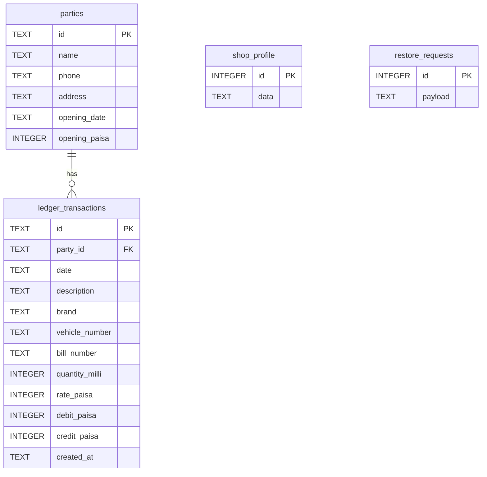

# Database and migrations

## File location and identity

Native connection string: `sqlite:alfazal.db`.

Normal Windows location: `%APPDATA%/com.alfazal.ledger/alfazal.db`. SQLite may also create `-wal` and `-shm` files.

The application identifier and filename are intentionally unchanged after generic rebranding. Changing only those values can make existing records appear missing by opening a new data location.

## Schema

### parties

| Column | Meaning / constraints |
|---|---|
| id | Non-null text primary key, UUID generated by the form |
| name | Trimmed nonempty, 1–120 characters |
| phone / address | Non-null strings, default empty |
| opening_date | ISO date text; SQL checks length 10; frontend validates real date |
| opening_paisa | Signed integer; absolute value at most 100,000,000,000 |

### ledger_transactions

| Column | Meaning / constraints |
|---|---|
| id | Non-null text primary key |
| party_id | Customer reference; restricted FK with migration-4 atomic customer/ledger deletion trigger |
| date | ISO date text; SQL length 10, frontend calendar validation |
| description | Trimmed nonempty, 1–240 characters |
| brand / vehicle_number / bill_number | Non-null strings, default empty |
| quantity_milli | Nonnegative integer thousandths |
| rate_paisa | Nonnegative integer rate per unit |
| debit_paisa / credit_paisa | Nonnegative integers; exactly one must be greater than zero |
| created_at | Non-null timestamp string; frontend checks parseability |

Numeric transaction fields are capped at 100,000,000,000 each. The index `ledger_party_date` covers `party_id, date, created_at, id`.

### shop_profile

One row, `id=1`. `data` contains a JSON object validated in TypeScript. The JSON stores the ShopProfile shape described in [[06 Interface Profile and Suggestions]]. SQL checks that the payload is valid JSON and an object; field-level limits are enforced by `validateProfile`.

### restore_requests

Transient staging table containing a valid JSON payload. Successful restore deletes its own request row. Do not use it as a backup archive.

## Migrations and triggers

### Migration 1 — 001_initial.sql

Creates parties, ledger_transactions, index, three date guards, restore_requests and the initial restore trigger.

- `ledger_date_insert`: requires an existing customer and transaction date on/after opening.
- `ledger_date_update`: enforces the same rule on edits.
- `opening_date_update`: prevents moving the opening date past an existing transaction.
- `restore_snapshot`: initially restores customers/transactions atomically.

### Migration 2 — 002_shop_profile.sql

Creates the singleton shop profile with generic defaults. Drops and recreates only the restore trigger to also restore profile data when present. Existing customers and transaction values are not rewritten.

Both migrations are registered in `src-tauri/src/lib.rs` using `MigrationKind::Up` and the same SQLite connection string. The SQL plugin tracks applied migrations.

## Why restore uses a trigger

SQL plugin operations use a connection pool. Issuing a frontend BEGIN, multiple separate execute calls, then COMMIT could accidentally use different connections.

Instead, restore performs **one bound INSERT** into restore_requests. Its trigger deletes old transactions/customers, inserts the incoming records, conditionally updates the profile, and deletes the request. SQLite treats the statement atomically; a constraint failure rolls back the deletes and inserts together.

The trigger's statement-level atomicity is covered by tests, including deliberately invalid incoming dates.

## How to change the schema safely

1. Back up representative data.
2. Leave shipped migrations 1 and 2 unchanged.
3. Add `003_description.sql` with additive/evolutionary changes.
4. Register migration version 3 in `lib.rs`.
5. Update domain types, validation, storage SQL, forms, exports and backup handling.
6. Test upgrading an existing version-2 database, not only a fresh database.
7. Confirm invalid restores still roll back completely.
8. Document the compatibility policy and refresh these notes.

No migration should silently change financial meaning or discard customer records. Do not rename the app identifier/database merely to change visible branding.

## Boundaries

Running balances are not persisted. Full-store reads and per-customer in-memory calculations are the current implementation; very large datasets may need SQL aggregation/pagination. Per-field integer limits exist, but aggregate safe-integer limits and concurrency across multiple application instances are not separately enforced.

Raw external SQL edits can bypass frontend calendar/text validation. The normal UI and backup path perform validation.

## Migration 4 — customer archive and deletion

Adds archived 0/1 (default active), updates restore to preserve archive flags with legacy default 0, and adds a BEFORE DELETE trigger to remove the selected customer’s transactions atomically. See [[15 Customer Archive Restore and Delete]].

## Migration 5 — suppliers

Adds independent suppliers, supplier_transactions and supplier_bill_requests tables, date/deletion triggers, atomic grouped bill saves and combined snapshot restore. Existing customer tables and migrations 1–4 are preserved. See [[16 Purchase and Supplier Ledger]].

## Daily cash book update

Migration 6 adds customer payment methods, cash tables, atomic source projections and cash snapshot restore. Earlier migrations remain unchanged. See [[17 Daily Cash Book and Expenses]].

## 0.1.5 — Advanced search and collections (2026-10-19)

Topbar Ctrl+K search, archived-account jumps, outstanding customer dues with FIFO aging and optional actual due dates. Migration 7 adds blank-default due-date fields; backups are now v5 with v1–v4 compatibility. See [[Alfazal Ledgher System/Shop Ledger Documentation/18 Advanced Search and Outstanding Dues]] for behavior, source map and verification.
